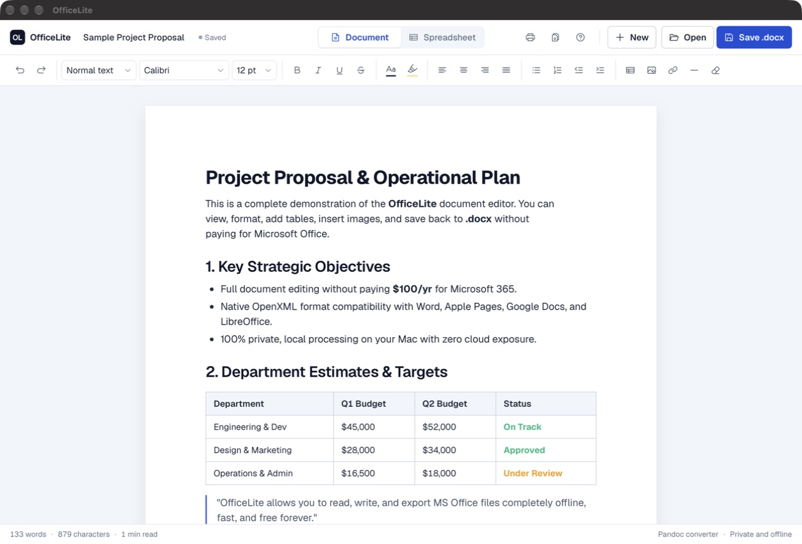
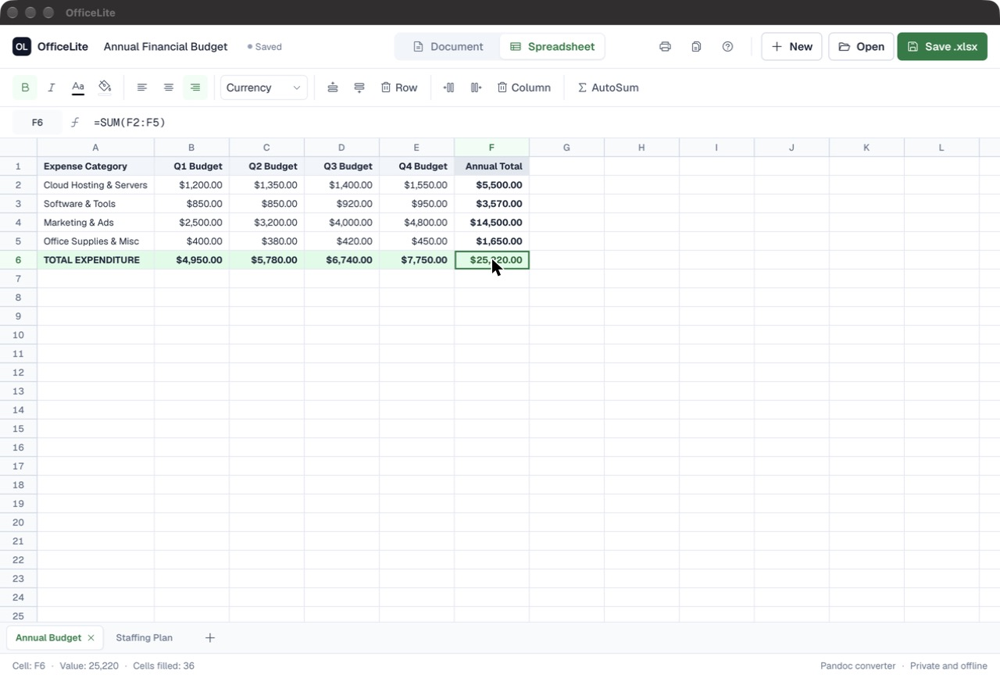

# OfficeLite 🦀📄📊
### Native Rust Desktop Word (.docx) & Excel (.xlsx) Viewer & Editor
**Zero Localhost &bull; Zero Network Ports &bull; 100% Native macOS ARM64 &bull; 3.1 MB Binary**

**OfficeLite** is a blazingly fast, standalone desktop app built in **Rust** (powered by Tao + Wry / macOS WebKit) so you never need to pay for a Microsoft 365 / MS Office subscription.





---

## ⚡ Why Rust Instead of Electron or Localhost?

| Metric | 🐌 Electron App | 🌐 Python Localhost | 🦀 **OfficeLite (Rust)** |
| :--- | :--- | :--- | :--- |
| **Localhost Server** | Often required | Required (`:8765`) | **None (Zero Ports)** |
| **Binary Size** | ~200 MB+ | ~50 MB+ runtime | **3.1 MB (Total)** |
| **RAM Usage** | ~300 MB - 600 MB | ~80 MB | **~35 MB** |
| **Startup Time** | 2.5 - 4.0 seconds | 1.5 seconds | **< 0.2 seconds** |
| **Engine** | Bundled Chromium | External Browser | **Native Apple WebKit** |
| **Network Exposure**| Local ports | Port 8765 | **Zero Open Sockets** |

---

## 🚀 Build and Run

OfficeLite is built from source. You need a Mac with the [Rust toolchain](https://rustup.rs) installed.

```bash
git clone https://github.com/artcreator329/OfficeLite.git
cd OfficeLite
```

Build a double clickable app at `target/release/OfficeLite.app`, which you can drag into `/Applications`:

```bash
./scripts/make-app.sh
```

Or run it directly:

```bash
cargo run --release
```

[Pandoc](https://pandoc.org) is optional. If it is installed, OfficeLite uses it for higher fidelity `.docx` conversion. Otherwise it uses its built in converter.

---

## ✨ Features

### 📄 Word Document Editor (.docx, .doc, .html, .txt)
- **View & Edit .docx Files**: Drag and drop any Word document directly into the app window.
- **Rich Typography & Formatting**: Headings (H1, H2, H3), Paragraphs, Quotes, Code blocks.
- **Font & Size Selection**: Calibri, Arial, Times New Roman, Georgia, SF Pro, Geist, etc.
- **Styling**: Bold, Italic, Underline, Strikethrough, Text Color, Highlight Color.
- **Lists & Alignment**: Bulleted lists, Numbered lists, Indent/Outdent, Left/Center/Right/Justify.
- **Insertables**:
  - Interactive **Tables** (customizable rows and columns).
  - **Images** (file upload, clipboard paste, or drag & drop).
  - **Hyperlinks** and dividers.
- **Document Stats**: Live word count, character count, and estimated reading time.
- **Exporting**:
  - **Save as .docx** (Cmd+S): Choose the location in the native macOS Save panel. Uses Pandoc when it is installed, otherwise the built in converter.
  - **PDF / Print** (Cmd+P): The native macOS print panel, including Save as PDF.

### 📊 Excel Spreadsheet Editor (.xlsx, .xls, .csv)
- **View & Edit .xlsx Workbooks**: Open multi-sheet Excel files or CSVs with drag and drop.
- **Formula Engine**:
  - `=SUM(A1:A10)`
  - `=AVERAGE(B2:B20)`
  - `=COUNT(C1:C15)`
  - Arithmetic: `=A1 * 1.08`, `=(B2 - C2) / 2`
  - Real-time recalculation across cells.
- **Cell Formatting**: Bold, Italic, Text Color, Background Fill, Text Alignment.
- **Number Formats**: Currency (`$1,234.50`), Percentage (`12.5%`), Decimals, Integers, and Plain Text.
- **Grid Manipulation**: Insert row above/below, delete row, insert column left/right, delete column.
- **Multi-Sheet Management**: Switch sheets, add new sheets (`+`), double-click to rename, or delete sheets.
- **Clipboard**: Cut, copy, and paste cells. Tab separated rows from Excel, Numbers, or a web table fill the grid.
- **Exporting**: Save as `.xlsx` (Cmd+S) through the native macOS Save panel. Bold, italic, colors, fills, alignment, and number formats are kept.

---

## 🔒 100% Private & Offline
- **Zero Localhost**: Communicates using an in-memory custom protocol (`officelite://`). It does not open any network sockets or listen on any ports.
- **Self-Contained**: All HTML, CSS, JavaScript, and libraries (SheetJS, Mammoth, JSZip) are compiled directly into the Mach-O binary.
- **Auto-Save Protection**: Real-time autosave to local application storage.

---

## ⚠️ Known Limits
- Spreadsheets have no undo yet, and a selection is a single cell.
- `.xlsx` files keep the formatting listed above. Borders, merged cells, charts, and theme colors are not preserved.
- Date cells open as their underlying numbers.
- Save asks for a location each time.

## 📜 License
[ISC](LICENSE). Bundled components keep their own licenses, listed in [THIRD_PARTY_NOTICES.md](THIRD_PARTY_NOTICES.md).

OfficeLite is an independent project and is not affiliated with or endorsed by Microsoft.
